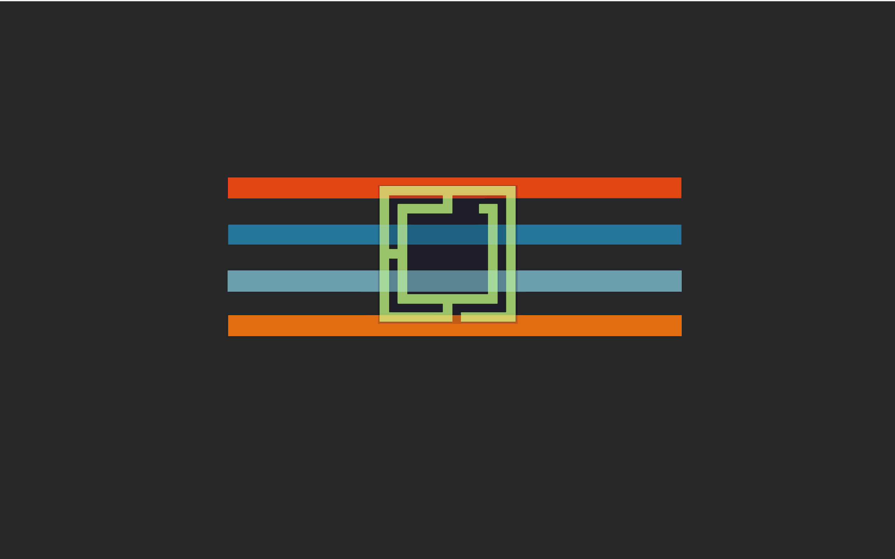

# Elegant Omarchy

A dark Omarchy theme inspired by Elegant-Brit by fmrbpensador, which itself was  
based on Elegant One by Dzakusek. To the best of my knowledge, Elegant-Brit was   
abandoned circa 2012 so this is a modernized Omarchy resurraction of Elegance..



## Install

Install from GitHub with Omarchy:

```bash
omarchy theme install https://github.com/signaldirective/elegant-omarchy
omarchy theme set elegant-omarchy
```

Or clone the repository into `~/.config/omarchy/themes/elegant-omarchy/` and select
it with `omarchy theme set elegant-omarchy`.

## What's included

- Two elegant-brit wallpapers.
- A complete dark palette for Omarchy and terminal applications.
- An updated color palette (from 6 colors to 24 colors)
Apply with:

```bash
omarchy theme set elegant-omarchy
```
